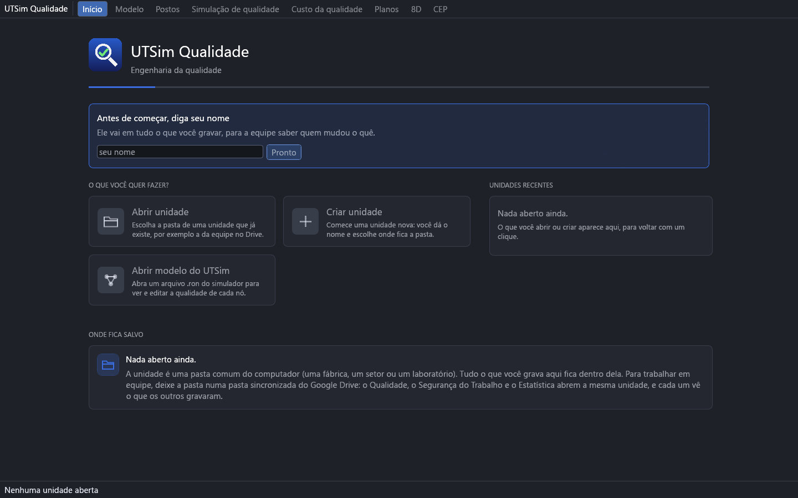
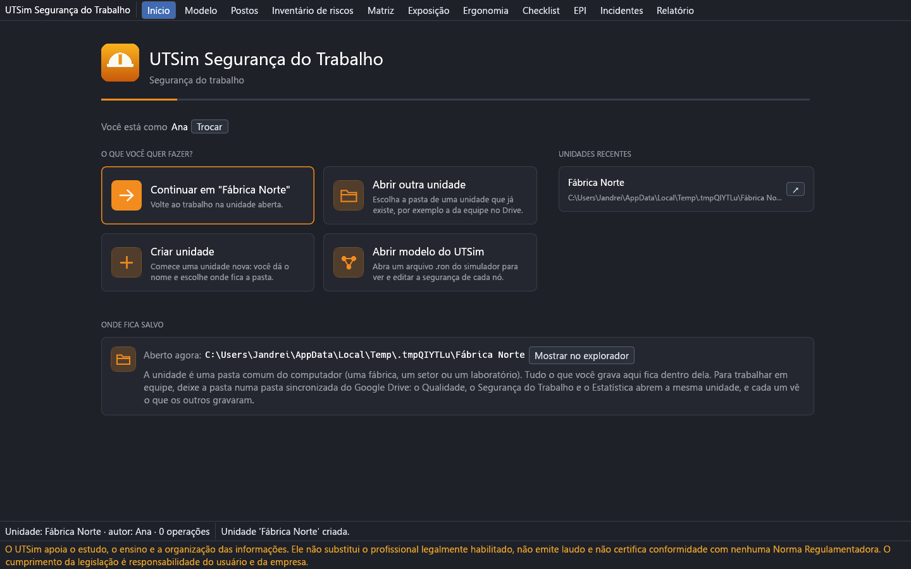
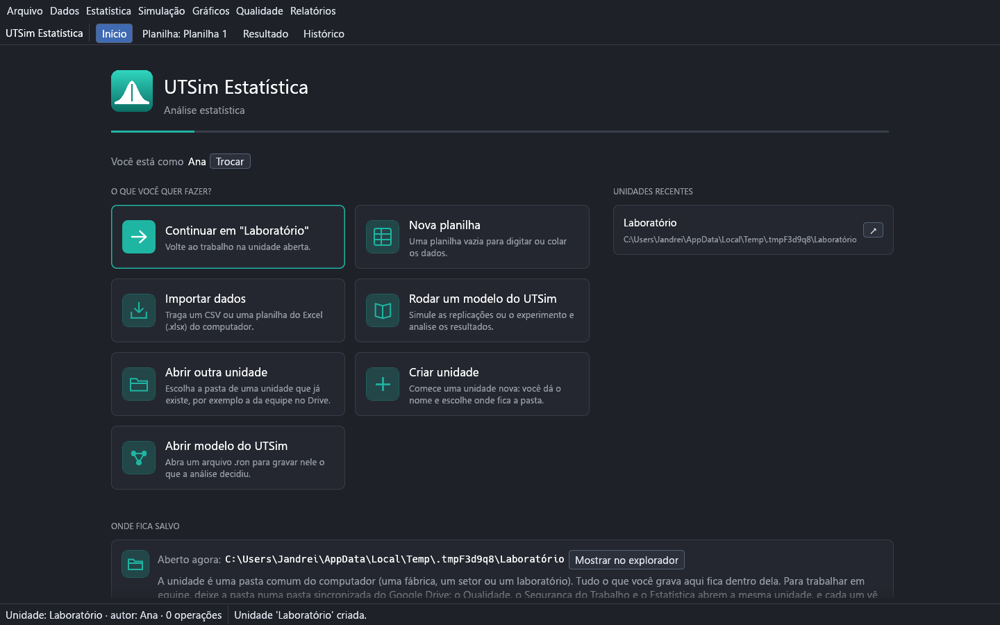
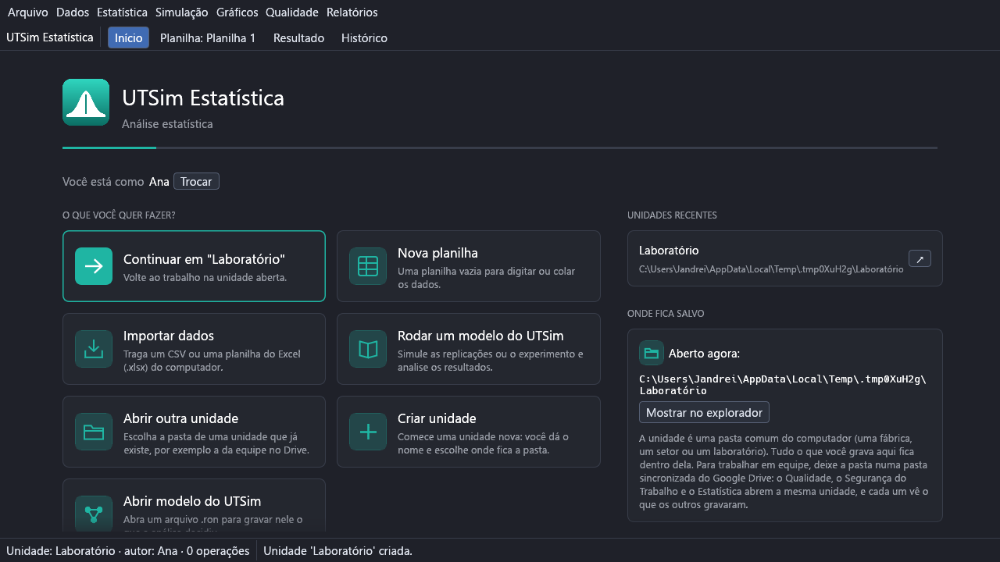
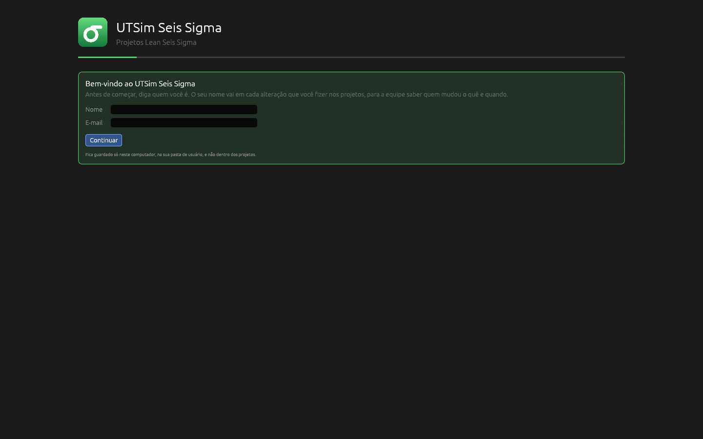
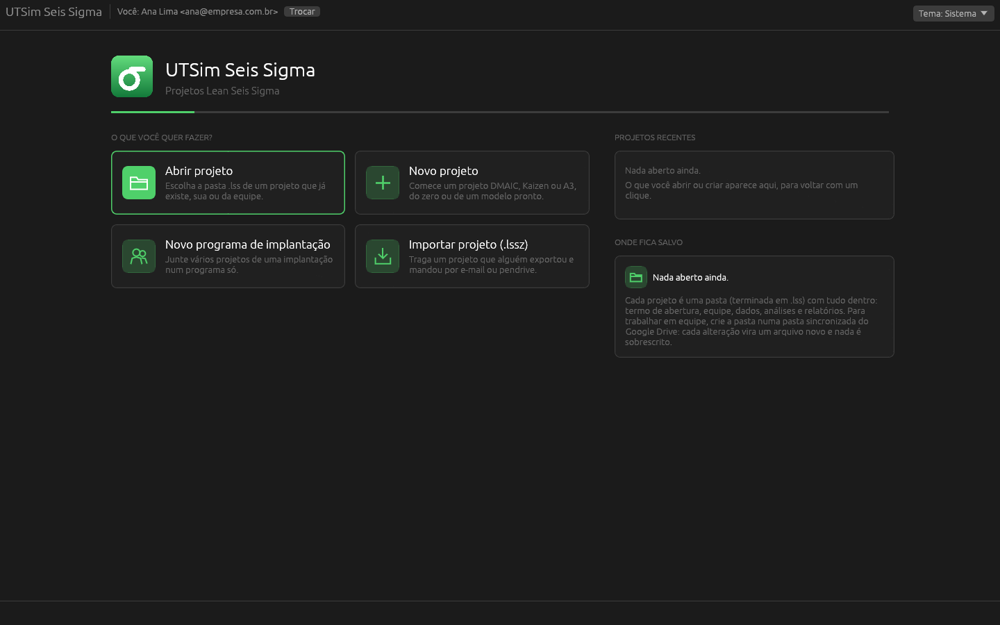
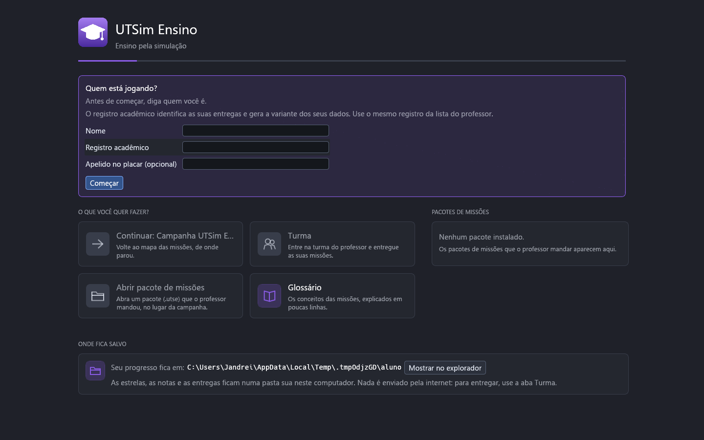
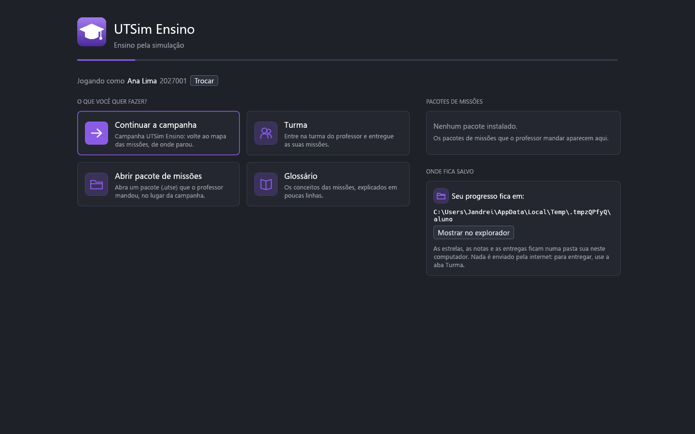
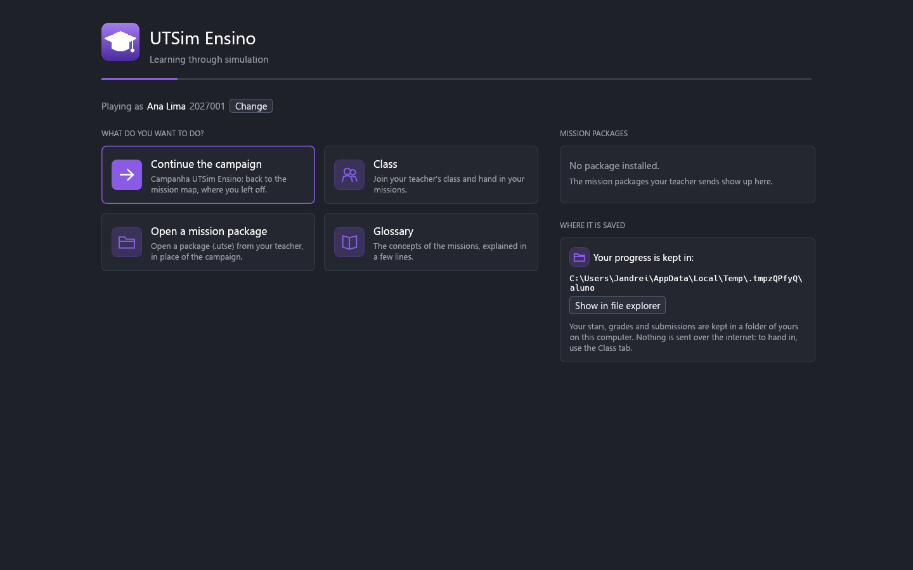
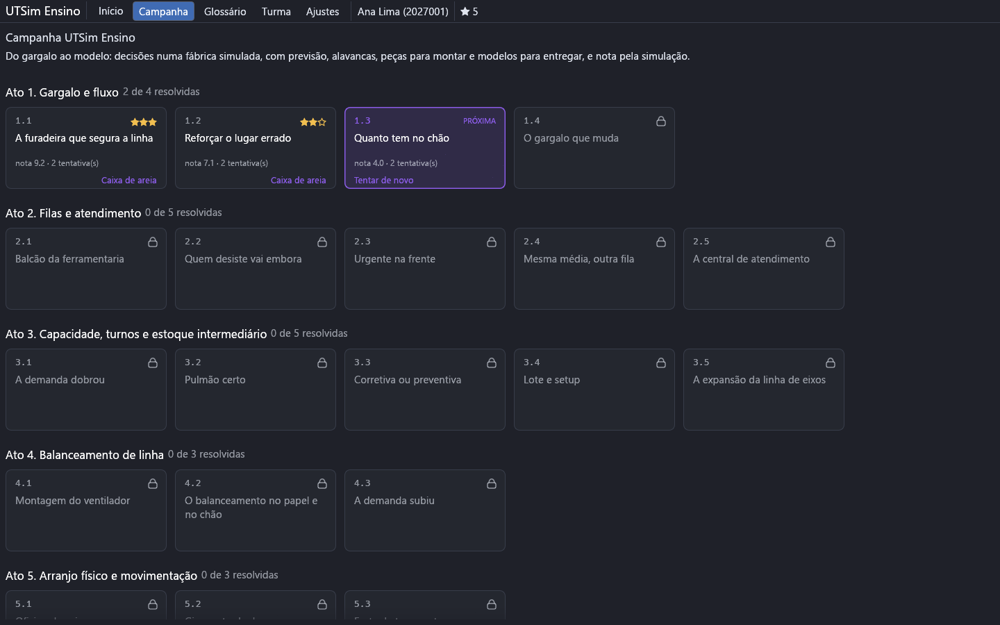

# Abertura dos apps e acesso a arquivos

Padrão comum da tela inicial dos apps da família (Qualidade, Segurança do Trabalho,
Estatística, Seis Sigma e Ensino). O simulador UTSim fica como está: ele é a referência.

## O que estava confuso (09/11/2026)

- A tela inicial era um formulário: nome, caminho da pasta e nome da unidade na mesma
  grade, com dois botões pequenos. Não ficava claro o que fazer primeiro.
- O caminho da pasta tinha de ser digitado à mão. Nenhum campo abria o explorador de
  arquivos do Windows. O Seis Sigma tinha um seletor próprio, diferente do Windows.
- Não havia lista de recentes nos apps de unidade. Também não se via onde o trabalho
  ficava salvo depois de aberto.
- O Ensino ia direto para o mapa da campanha. As outras ações (turma, pacotes) ficavam
  escondidas no fim da tela ou em abas.
- As janelas não abriam maximizadas de verdade: o Windows marcava a janela como
  maximizada, mas ela ficava com o tamanho inicial.

## O padrão

Toda abertura tem, de cima para baixo:

1. **Cabeçalho:** o ícone, o nome e o subtítulo do app (os mesmos do lançador), com uma
   linha na cor do app.
2. **Quem é você:** se falta o nome, um quadro em destaque pede o nome antes de tudo. Se
   já tem, aparece numa linha ("Você está como Ana · Trocar").
3. **O que você quer fazer?:** ações grandes, cada uma com ícone, título e uma linha em
   linguagem simples. A principal tem a cor do app. Uma ação que ainda não pode ser usada
   fica apagada e diz por quê ao passar o mouse.
4. **Recentes:** à direita, um clique para voltar. Um item que sumiu aparece apagado, com
   um botão para tirá-lo da lista.
5. **Onde fica salvo:** à direita, embaixo dos recentes, sempre à vista (também em
   1280x720). Mostra a pasta aberta e o botão "Mostrar no
   explorador", e explica a pasta em linguagem simples (inclusive o Google Drive para
   trabalhar em equipe).

Criar algo novo abre uma janela pequena: o nome, a pasta (com "Procurar…") e a linha
"Será criada a pasta: …" antes de confirmar.

Todo campo de caminho ou pasta, em todos os apps, tem o botão **Procurar…**, que abre o
seletor do Windows (crate `rfd`, versão fixada). A caixa de texto continua lá para quem
prefere colar o caminho.

## O que é comum e o que é de cada app

| Onde | O quê |
|---|---|
| `utsim-ui-tema`, módulo `abertura` | O desenho: cabeçalho, cartões de ação, recentes, "onde fica salvo", quadro em destaque, textos traduzíveis (`Rotulos`). |
| `utsim-ui-tema`, módulo `arquivos` | O seletor nativo (`procurar`), o campo com "Procurar…" (`campo`), "Mostrar no explorador", filtros prontos (.ron, .csv, planilha, PDF, HTML). |
| `utsim-ui-tema::maximizar_no_inicio` | Maximiza a janela de verdade nos primeiros quadros. |
| `utsim-posto-ui`, `inicial.rs` | A abertura dos apps de unidade: autor, abrir ou criar unidade, recentes e o modelo do UTSim. Aceita ações extras de cada app. |
| Qualidade e Segurança | Continuar, abrir ou criar unidade e abrir modelo do UTSim. |
| Estatística | Também: nova planilha, importar dados (CSV ou Excel) e rodar um modelo do UTSim. As planilhas da unidade aparecem embaixo. |
| Seis Sigma | Abrir projeto, novo projeto, novo programa e importar `.lssz`. A tela de identidade usa o mesmo cabeçalho. |
| Ensino | Quem está jogando, continuar a campanha, turma, abrir pacote, glossário (e professor). Os textos estão nas três línguas. |

## Imagens

Feitas sem janela pelos testes `tests/abertura.rs` de cada app
(`UTSIM_CAPTURAS=<pasta> cargo test --test abertura`).

## Mapa da campanha do Ensino

Cada ato é uma faixa de cartões, um por missão: número, título, estrelas, melhor nota e
cadeado quando bloqueada (o motivo aparece ao passar o mouse). A próxima missão a fazer
fica na cor do app, com "Começar" ou "Tentar de novo". Uma missão resolvida tem o link
"Caixa de areia" no canto.

